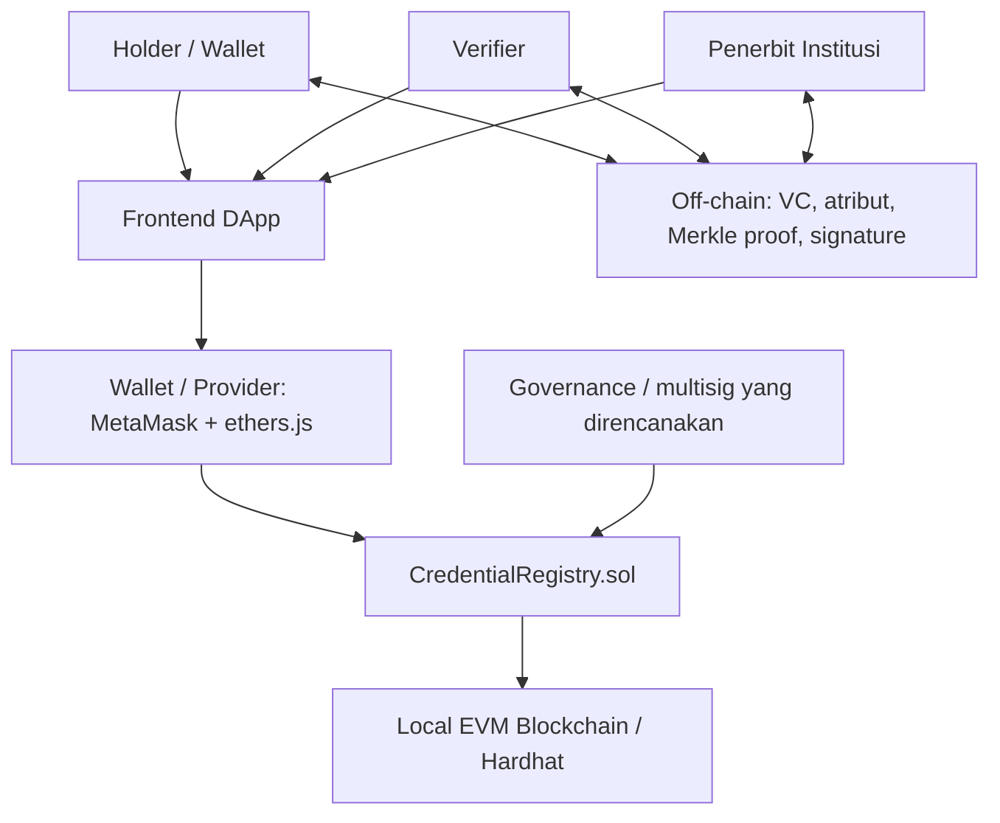

# PROJECT 1 — Desain Solusi, Smart Contract, dan Arsitektur DApp

## 1. Ringkasan solusi

VeriKred adalah prototipe registry untuk verifikasi kredensial pendidikan. Smart contract menyimpan jangkar kredensial dan status penerbitan, bukan ijazah atau data pribadi. Data kredensial lengkap dan bukti Merkle ditangani di luar blockchain. Verifier membandingkan `credId` dan `root`, lalu memeriksa status, masa berlaku, dan apakah penerbit ditandai mengalami kompromi.

**Batas klaim:** kontrak yang tersedia merupakan registry jangkar. Kontrak tidak memverifikasi tanda tangan Verifiable Credential, tidak memvalidasi proof Merkle, dan tidak menegakkan kuorum 2-dari-3 di dalam kontrak. Fungsi `rebind` mengandalkan kontrol maker-checker pada smart account/penerbit di luar kontrak. Ini harus disampaikan saat demo.

## 2. Aktor dan kebutuhan trust

| Aktor | Tanggung jawab | Trust/risiko |
|---|---|---|
| Governance | Menetapkan penerbit, menandai kompromi, memulai alih governance | Akun governance harus dikendalikan institusi; idealnya multisig/timelock |
| Penerbit terdaftar | Menerbitkan, menangguhkan, mengaktifkan kembali, mencabut, mengganti versi, memperbarui binding kredensial miliknya | Hanya alamat yang terdaftar boleh menulis; penerbit tidak boleh mengubah kredensial penerbit lain |
| Holder | Menyimpan kredensial dan memilih atribut yang dibagikan | Data lengkap dan kunci holder tidak diletakkan di chain |
| Verifier | Meminta atribut tertentu dan memeriksa status jangkar | Tidak boleh menganggap status on-chain saja membuktikan semua klaim dalam kredensial |
| Operator/node | Menjalankan node dan menjaga ketersediaan jaringan lokal | Pada prototipe, node lokal dikendalikan pengembang; belum ada desentralisasi operasional |

## 3. Aset/data utama

- `credId`: identifier unik kredensial (`bytes32`).
- `root`: Merkle root atribut kredensial yang telah diberi salt.
- `holderBinding`: hash pengikat identitas/kunci publik holder.
- `issuer`, `issuedAt`, `expiry`, `status`: metadata minimum untuk otorisasi dan validasi siklus hidup.
- Off-chain: atribut pendidikan, dokumen asli, proof Merkle, tanda tangan VC, nonce/audience presentasi, data pemulihan holder, dan log operasional.

## 4. Keputusan on-chain/off-chain

| Data | Lokasi | Alasan |
|---|---|---|
| credId, root, issuer, waktu terbit/kedaluwarsa, status | On-chain | Perlu konsistensi status dan jejak perubahan yang dapat diperiksa lintas verifier |
| Nama, NIM, IPK, nomor ijazah, tanggal lahir, dokumen PDF | Off-chain | Mengurangi paparan data pribadi; blockchain publik bersifat sulit dihapus |
| Bukti Merkle, signature VC, atribut selektif | Holder/verifier/off-chain | Ukuran dan kerahasiaan; harus divalidasi oleh client/backend, bukan diklaim dilakukan kontrak |
| Private key/seed phrase | Wallet/keystore aman saja | Tidak boleh masuk repository atau data on-chain |

Catatan: `holderBinding` dan root tetap dapat menimbulkan risiko korelasi bila dibangun tanpa salt yang kuat atau digunakan ulang. Jangan mengklaim unlinkability mutlak.

## 5. Alur transaksi

1. Governance mendaftarkan alamat penerbit melalui `setIssuer`.
2. Penerbit membentuk kredensial dan Merkle root bergaram di luar chain.
3. Penerbit memanggil `issue(credId, root, holderBinding, expiry)`; kontrak mencatat jangkar dan memancarkan `Issued`.
4. Holder menyajikan atribut yang diminta dan proof ke verifier melalui kanal aplikasi.
5. Verifier/client memvalidasi signature dan proof secara off-chain, lalu membaca `check(credId, root)` untuk status, root, expiry, dan kompromi penerbit.
6. Penerbit dapat `suspend`, `reinstate`, `revoke` atau `supersede`; setiap perubahan status memancarkan `StatusChanged`.
7. Jika perlu pemulihan binding, penerbit memanggil `rebind`; kebijakan maker-checker harus diterapkan oleh multisig/smart account atau proses institusional di luar kontrak.

## 6. Arsitektur

## 7. Role dan aturan bisnis kontrak

- `onlyGovernance`: `setIssuer`, `markIssuerCompromised`, `transferGovernance` hanya governance aktif.
- `issue`: hanya alamat pada `isIssuer` yang boleh menerbitkan; `credId` tidak boleh digunakan ulang dan root tidak boleh nol.
- `onlyIssuerOf`: perubahan status dan rebind hanya oleh penerbit pemilik record.
- `suspend` hanya dari ACTIVE; `reinstate` hanya dari SUSPENDED; `revoke` final dari ACTIVE/SUSPENDED; `supersede` menandai versi lama dan membuat versi baru.
- `acceptGovernance`: alih governance dua langkah agar alamat penerima harus menerima peran.
- `check`: `valid=true` hanya bila status ACTIVE, root cocok, penerbit tidak terkompromi pada waktu terbit, dan belum kedaluwarsa.

## 8. Trade-off dan keterbatasan

- Keuntungan: perubahan status dapat ditelusuri; pembacaan status dapat diverifikasi lintas organisasi; data pribadi tidak disimpan langsung di chain.
- Biaya: transaksi tulis membutuhkan gas dan operator; kesalahan status dapat berdampak luas; data yang salah tetap bisa diberi jangkar oleh penerbit yang sah.
- Blockchain tidak menjamin kebenaran data akademik sumber. Governance penerbit, validasi dokumen, keamanan kunci, dan prosedur koreksi tetap diperlukan.
- Untuk satu institusi dengan operator tunggal, database append-only bertanda tangan mungkin lebih murah. Blockchain lebih masuk akal jika beberapa institusi yang independen perlu berbagi registry tanpa satu operator tunggal.
- Prototipe lokal tidak membuktikan kinerja, finalitas, desentralisasi, atau keamanan produksi.
